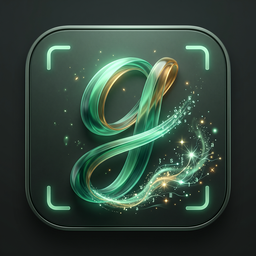

<div align="center">

<h1>Glossa</h1>
<p><strong>Your words. Your pace.</strong><br />Selection and screenshot translation, with vocabulary grounded in context.</p>

[](https://github.com/conanxyz/glossa/actions/workflows/ci.yml)

[](LICENSE)

[中文](README.md) · [Contributing](CONTRIBUTING.md)
</div>

Development preview. Apple Silicon has been tested locally; Intel builds require
hardware validation. No initial GitHub release has been published yet.


- Capture selected text with Option+D or a screen region with Option+S, review it,
  then press X to translate. OCR runs locally.
- Stream translation as it arrives; safely render Markdown or read plain text.
  Vocabulary metadata is processed separately without blocking visible text.
- Collect contextual vocabulary, merge examples, add notes, and export CSV,
  Markdown or Anki TSV. The left sidebar preserves the reading anchor and respects manual collapse for the current attempt.
- Use native lemmatization and the macOS dictionary without a remote model call.
- Detect common secret formats locally before captured text reaches the UI or
  network. Detection is conservative and may miss secrets; review what you send.
- Store API keys in Keychain. Remote translation sends text to the selected
  provider; local history retention is configurable.

Providers: custom OpenAI-compatible endpoints, DeepSeek, MiniMax, Gemini, OpenAI,
Claude, Qwen, Zhipu, SiliconFlow, OpenRouter, Youdao and the local system dictionary.
Free tiers depend on account eligibility, limits and provider policy.

## Install

When available, download a `.dmg` from [Releases](https://github.com/conanxyz/glossa/releases):
`aarch64` for Apple Silicon, `x64` / `x86_64` for Intel. macOS 14 or newer is required.
Move Glossa into Applications, configure a service, and allow Accessibility and
Screen Recording in System Settings. Application archives and checksums accompany releases.

Development builds are ad-hoc signed, not Apple-notarized. Prefer “Open Anyway”
in Privacy & Security. Only after verifying the official source and SHA-256, a
quarantine-related damaged-app warning can be addressed manually with:

```sh
sudo xattr -rd com.apple.quarantine /Applications/Glossa.app
```

This removes quarantine; it does not notarize or establish trust in a binary.

## Develop

Install Xcode Command Line Tools, rustup, Node.js 24 and Python 3.11+. Rust is pinned in the
repository. Use npm and the committed lockfile.

```sh
npm ci
npx playwright install chromium
npm run tauri -- dev
./scripts/verify.sh
sh scripts/test-native.sh
npm run bundle:mac
```

CI runs on macOS. Version tags or manual release runs build both architectures
with `tauri-action` and upload DMG/application archives to a draft release after
checks pass. Hosted builds are unverified until the repository is pushed.
See [CONTRIBUTING.md](CONTRIBUTING.md) and [AGENTS.md](AGENTS.md) for architecture,
security, testing and release requirements.

## License

Copyright © 2026 Glossa Contributors. **GPL-3.0-only**; see [LICENSE](LICENSE).
Third-party components retain their own licenses and trademarks; see
[THIRD_PARTY_NOTICES.md](THIRD_PARTY_NOTICES.md).
