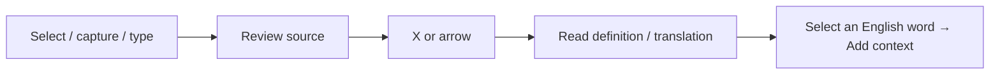

<div align="center">
  
  <h1>Yurelay</h1>
  <p><strong>Your words. Your pace.</strong><br />Selection and screenshot translation for macOS, with English vocabulary grounded in context.</p>


[](LICENSE)


[简体中文](README_cn.md) · [Downloads & releases](https://github.com/conanxyz/yurelay/releases) · [Contribute](CONTRIBUTING.md)
</div>

<p align="center">
  <picture>
    <source media="(prefers-color-scheme: dark)" srcset="docs/images/readme-translation-dark.png" />
    
  </picture>
</p>

<p align="center">Understand what you are reading. Keep the expressions worth remembering.<br />
<a href="docs/images/readme-translation-light.png">Light appearance</a> · <a href="docs/images/readme-translation-dark.png">Dark appearance</a></p>

## 💡 Why Yurelay?

- **Review before translating.** Capture text, check or edit the source, then press `X` or click the arrow to request a translation. You choose when to send it.
- **Check sensitive text locally.** SensitiveGuard checks common seed-phrase, private-key and API-key formats, hiding matches and blocking them from sending.
- **Keep words with their context.** Look up and collect English source words, normalize inflections and keep encounters from different articles together.
- **Use your Mac's local tools.** OCR, system dictionary lookup and speech run locally. Yurelay is built with Tauri 2, Rust and Svelte 5, with service keys stored in macOS Keychain.

## ⚡ From capture to reading

Select text in another app and press the default **`Option + D`** shortcut, or use **`Option + S`** to capture a screen region. You can also type or paste into the translation window.



Reading mode displays paragraphs, headings, lists and code blocks. Switch to plain text, or copy the translation and Markdown separately. Hiding the window lets an active translation continue.

<details>
<summary>Watch the native walkthrough: preview → translate → look up → collect</summary>

<picture>
  <source media="(prefers-reduced-motion: reduce)" srcset="docs/images/readme-translation-light.png" />
  
</picture>

The clip starts with source text already entered. A local sample response demonstrates the interaction; it is not a benchmark of a remote model.

</details>

## 📚 Dictionary lookup and contextual vocabulary

**Looking up a word?** Set **macOS system dictionary** as the default in Settings → Services to query enabled local dictionaries without an API key. With a model service selected, Yurelay chooses dictionary or passage instructions based on the input.

For a sentence or paragraph, the system dictionary offers configured translation services for the current query. Choose one, then press `X` or click the arrow to translate; your default service stays the same.

**Want to remember an expression?** Click or select an English source word for native lemmatization and a dictionary preview, then click **Add**. You can also collect words suggested by the model.

- Keep multiple source sentences and available meanings under one word; adding the same sentence again does not increase its count.
- Add personal notes, track Learning / Mastered status and search words or contexts.
- Use UK / US pronunciation and slower playback when matching system voices are available.
- Export **CSV, Markdown or Anki TSV** for further study.


## 🕘 Revisit what you have read

In **Settings → History**, search source or translation text and filter selections, screenshots and typed text. Review the source, edited text, saved screenshot and translation, copy content or reopen the result window.

History defaults to **7 days**. Choose a custom duration, keep it forever or disable disk saving. Explicitly collected vocabulary is saved separately for longer-term study.


## 🔌 Bring your own translation service

| Service | Setup |
| :--- | :--- |
| macOS system dictionary | No key; uses enabled local dictionaries |
| Zhipu, SiliconFlow, DeepSeek, Qwen | API key + model name |
| Gemini, OpenAI, Claude | Provider API key + model name |
| MiniMax | Choose China or international region and its matching key |
| OpenRouter | API key + model ID |
| Youdao | Application ID + application secret |
| Custom service | OpenAI-compatible endpoint + model; key if required |

Open Settings → Services, choose a provider, configure it, test the connection, then set it as default and save. Presets include models such as Zhipu's `glm-4-flash-250414`; pricing, free allowances and availability depend on the provider. Connection tests send fixed sample text and may incur a charge.

## 🚀 Install and get started

Requires **macOS 14 or newer**. When a package is published, download its `.dmg` from [Releases](https://github.com/conanxyz/yurelay/releases), open it and drag Yurelay into Applications. Choose `aarch64` for Apple Silicon or `x64` / `x86_64` for Intel. If no package is available yet, build from source below. A Homebrew installation channel is not yet available.

1. Allow **Accessibility** for text selection and **Screen Recording** for screenshots.
2. Choose the system dictionary or configure a model in Settings → Services.
3. Capture some text, review it and click the arrow to begin.

<details>
<summary>First launch and permissions</summary>

The current workflow produces ad-hoc-signed development builds without Apple notarization. After confirming a trusted source, follow [Apple's instructions](https://support.apple.com/en-us/102445) to use **Open Anyway** in System Settings → Privacy & Security. If macOS reports a damaged file, check the file and release source first.

Accessibility enables selection from other apps; Screen Recording enables screenshots. Typing, pasting and local dictionary lookup do not require those two permissions. They are separate from signing, notarization and Keychain access. After updating a development build, consult Yurelay's permission recovery guide if needed.

</details>

## ⌨️ Shortcuts and interaction details

| Action | Default shortcut / entry point |
| :--- | :--- |
| Capture selected text | `Option + D` |
| Screenshot OCR | `Option + S` |
| Translate / expand or collapse translation | `X` or the arrow |
| Hide the result window | `Esc`; collapses an open vocabulary sidebar first |
| Reopen / settings | Menu bar icon or Dock |
| Export vocabulary | Settings → Vocabulary → Export |

<details>
<summary>Interaction details and FAQ</summary>

- **Can I change the shortcuts?** Yes, in Translation settings. The table shows defaults; your saved bindings take precedence and conflicts are reported.
- **Does X translate while I am typing?** In an input field, `X` types normally. Click the arrow or move focus outside the field before using the shortcut.
- **What happens if I press capture twice?** Duplicate requests are ignored during capture. The selection shortcut preserves the result while Yurelay has focus. A new screenshot can start after the current capture finishes or is cancelled.
- **What can I collect?** The source must be detected as English or explicitly set to English. A preview is saved only after clicking Add. Clicking or selecting translation text does not preview or collect vocabulary.
- **What limits apply to automatic extraction?** Enable it in settings for English source text. Inputs over 150 words or 800 characters skip automatic extraction; translation remains available.
- **Will a collapsed sidebar reopen?** Later model metadata does not reopen a manually collapsed sidebar. Deliberately selecting another source word can open its preview.
- **Does reading history call the model again?** No. A new request requires an explicit Translate again action.
- **What does history cleanup remove?** Expiry is based on creation time. Saving a shorter retention period removes expired records; disabling disk saving clears existing history. Deleting a record permanently removes its source, screenshot and translation after confirmation. Collected vocabulary is managed separately.
- **Do the Sentence / Dictionary mode buttons change translation mode?** In service settings, these buttons switch the default prompt preview. The input determines the actual processing mode.

</details>

## 🛡️ Privacy and security

Before captured text reaches the result window or a remote model, SensitiveGuard checks common English BIP-39 seed phrases, private-key formats and API keys. Matches are hidden and blocked from sending, and unreleased content is not saved to history. Detection can miss secrets or produce false positives; OCR and model output also need contextual judgment.

Service keys stay in **macOS Keychain**. Local OCR, dictionary lookup and speech do not require a remote model; remote translation sends the source to your chosen provider. Do not include keys or private captures in issue reports. See [SECURITY.md](SECURITY.md) for security reports.

The media was captured from the native macOS app using isolated sample data and a local demo response. System recording controls were cropped out and the clip was edited. Screenshots use the Chinese UI. See [media notes](docs/images/README.md).

## 🛠️ Build and contribute

Install Xcode Command Line Tools, rustup, Node.js 24 and Python 3.11+. The repository selects its pinned Rust toolchain.

```sh
npm ci
npx playwright install chromium
npm run tauri -- dev
./scripts/verify.sh
npm run bundle:mac
```

See [CONTRIBUTING.md](CONTRIBUTING.md) for architecture, development and release checks.

## 📄 License and acknowledgements

Copyright © 2026 Yurelay Contributors. Licensed under **GNU GPL v3.0 only (`GPL-3.0-only`)**; see [LICENSE](LICENSE).

Yurelay draws on the product and interaction design of [Easydict](https://github.com/tisfeng/Easydict) and [Bob](https://github.com/ripperhe/Bob). Easydict's implementations of text selection, screenshot capture, OCR and translation provider integrations were also studied during development. Thank you to these projects and their authors for sharing their ideas and experience.

Thanks to the Tauri, Rust, Svelte and wider open-source communities. See [third-party notices](THIRD_PARTY_NOTICES.md) for dependencies, fonts and provider marks.
