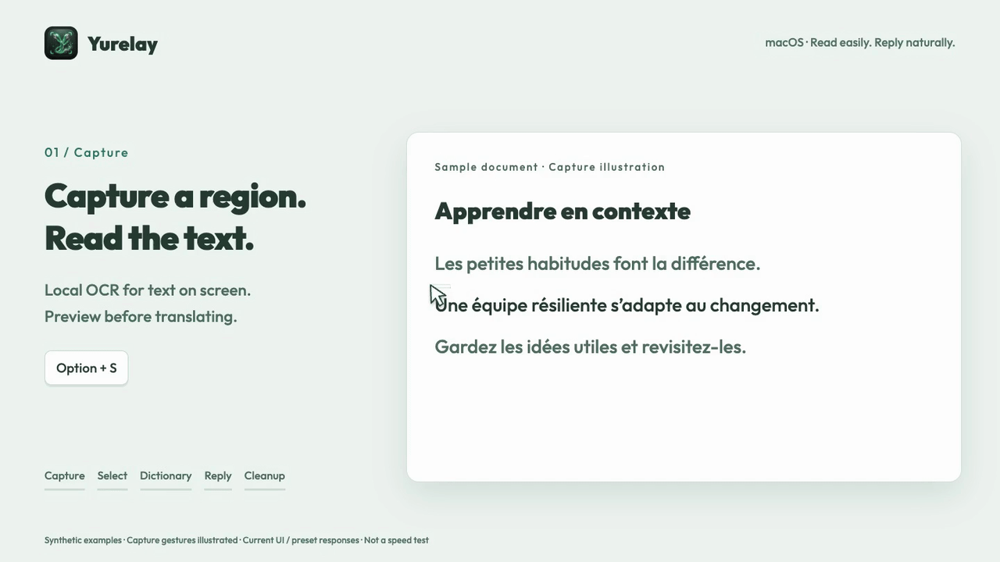

<div align="center">
  
  <h1>Yurelay</h1>
  <p><strong>Your language. Your pace.</strong><br />Selection and screenshot translation for macOS. Review first, translate on demand, save words in context and compose replies in your own words.</p>


[](LICENSE)


[简体中文](README_cn.md) · [Download](https://github.com/conanxyz/yurelay/releases) · [FAQ](docs/FAQ.md) · [Contributing](CONTRIBUTING.md)

<picture>
  <source media="(prefers-reduced-motion: reduce)" srcset="docs/images/yurelay-features-en-poster.png" />
  
</picture>

[Watch MP4](docs/images/yurelay-features-en.mp4) · [About the demo](docs/images/README.md)
</div>

<a id="features"></a>

## ✨ Why Yurelay?

For reading closely, building vocabulary and communicating across languages.

- **Review first. Translate on demand.** Preview selections or OCR text, clean up PDF line breaks, edit the source and append passages before pressing `D` / `S` to translate. Table layout and formula rendering help with structured content.
- **Compose replies in your own words.** Describe your intent in your native language to draft a contextual reply in the source language, with a reference back-translation. You can also request an explanation of a difficult passage.
- **Keep words with their context.** Select English source words for local lookup and lemmatization, then save them with the original sentence. Highlight words you are learning, use UK/US pronunciation and export **Anki TSV, CSV or Markdown**.
- **Local tools, your choice of service.** OCR, system dictionary lookup and speech run on your Mac. Look up words without an API key, or connect your own translation provider with custom prompts and optional fallback.
- **Check sensitive text before sending.** SensitiveGuard checks common BIP-39 seed-phrase, private-key and API-key formats, hiding matches and blocking them from sending. Service keys stay in macOS Keychain.

Remote translation sends the source to your chosen provider; sensitive-text detection can miss secrets or flag safe text. See [privacy and Keychain](docs/FAQ.md#privacy) for details.

<a id="install"></a>

## 🚀 Install and get started

Requires **macOS 14+**. Get the `.dmg` from [Releases](https://github.com/conanxyz/yurelay/releases) and drag Yurelay into Applications. Choose `aarch64` for Apple Silicon or `x64` / `x86_64` for Intel. If no matching package is available, build from source.

1. **Allow access:** Follow the prompts for Accessibility (selection capture) and Screen Recording (screenshots).
2. **Choose a service:** Select the local dictionary or configure a model in Settings → Services, set it as default and save.
3. **Start reading:** Select text and press `Option + D`, or capture a region with `Option + S`. Once the source is ready, release the shortcut and press `D` / `S` alone, or click the arrow.

Current builds are not notarized by Apple. See [installation and permissions](docs/FAQ.md#install) and [Keychain authorization](docs/FAQ.md#privacy) for first-launch help.

<a id="shortcuts"></a>

## ⌨️ Shortcuts and everyday actions

| Action | Default shortcut / entry point |
| :--- | :--- |
| Capture selected text | `Option + D` |
| Screenshot OCR | `Option + S` |
| Translate / expand or collapse translation | Press `D` / `S` alone once the source is ready, or click the arrow |
| Explain context / compose a reply | Buttons in the result window |
| Hide the window | `Esc`; closes an open vocabulary sidebar first |
| History / vocabulary | Corresponding Settings pages; history defaults to 7 days, vocabulary is managed separately |

See the [FAQ](docs/FAQ.md) for custom shortcuts, appended captures, history retention and interaction details.

<a id="services"></a>

## 🔌 Supported services

- **Local dictionary:** macOS system dictionary, with no API key.
- **Model providers:** DeepSeek, Zhipu, Qwen, SiliconFlow, MiniMax (China / international), OpenAI, Claude and Gemini.
- **Aggregators and translation APIs:** OpenRouter and Youdao.
- **Custom services:** OpenAI-compatible endpoints and models, with credentials as required.

Configure global or per-service prompts and optional automatic fallback (off by default). Model requests and connection tests may incur charges; pricing and availability depend on the provider. See [service configuration](docs/FAQ.md#services).

<a id="development"></a>

## 🛠️ Build locally

Install Xcode Command Line Tools, Rust (rustup), Node.js 24 and Python 3.11+. The repository selects its pinned Rust toolchain.

```sh
npm ci
npm run tauri -- dev
npm run bundle:mac
```

See [CONTRIBUTING.md](CONTRIBUTING.md) for testing, architecture and contribution guidelines, and [SECURITY.md](SECURITY.md) for reporting security issues.

## 📄 License and acknowledgements

Copyright © 2026 Yurelay Contributors. Licensed under **GPL-3.0-only**; see [LICENSE](LICENSE).

Yurelay's product and interaction design draw on [Easydict](https://github.com/tisfeng/Easydict) and [Bob](https://github.com/ripperhe/Bob). Easydict's implementations of selection capture, screenshots, OCR and service integrations were also studied during development. Thanks to their authors and the Tauri, Rust, Svelte and wider open-source communities. See [third-party notices](THIRD_PARTY_NOTICES.md) for dependency, font and provider-mark licenses.
