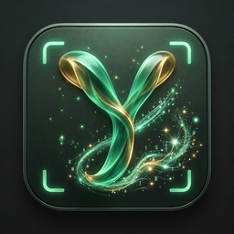
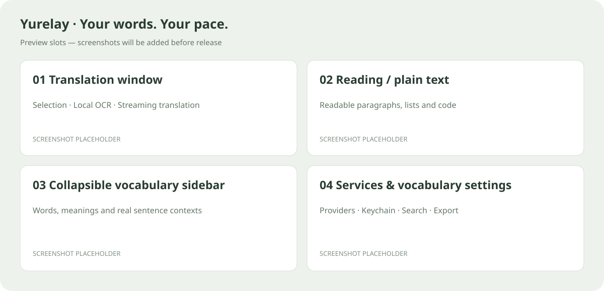

<div align="center">
  
  <h1>Yurelay</h1>
  <p><strong>Your words. Your pace.</strong><br />Lightweight selection and screenshot translation for macOS, with vocabulary grounded in context.</p>


[](LICENSE)


[简体中文](README_cn.md) · [Download](https://github.com/conanxyz/yurelay/releases) · [Contribute](CONTRIBUTING.md)
</div>

Understand what you are reading, and keep the expressions worth remembering.
Yurelay brings text capture, translation and contextual vocabulary into one compact window.



## ✨ Features

### ⚡ Capture, review, translate

Select text or capture a screen region with a global shortcut. OCR runs locally.
Review or edit the source, then press `X` or click the arrow to start streaming translation.

Reading mode displays headings, lists and code blocks, and helps recover formatting
lost when copying from PDFs, websites or changelogs. Switch to plain text without another model request.

### 📖 Vocabulary that keeps its context

Optionally extract 2–5 useful words, phrases or idioms alongside a translation.
The left sidebar preserves your reading position and respects manual collapse for the same task.

- **Two ways to collect:** save a suggested word, or select a word in the source
  and use native lemmatization and the system dictionary without spending model tokens.
- **One word, multiple contexts:** keep meanings, original sentences and encounter
  counts as you meet the word in different articles.
- **Ready for review:** pronunciation, mastery status, personal notes and
  **CSV / Markdown / Anki TSV** export.

### 🛡️ Check sensitive text locally

Before captured text reaches the result window or a remote model, SensitiveGuard
checks common English BIP-39 seed phrases, private-key formats and API keys.
Matches are hidden and blocked from sending; blocked content is not saved to history unless explicitly released.

Service keys stay in **macOS Keychain**. OCR and system dictionary queries are local;
remote translation sends text to the provider you choose. History retention is configurable.

Detection can miss secrets or produce false positives. Review text before sending,
and use your judgment when reading model-generated translations, formatting and definitions.

### 🔌 Use the service that suits you

Start with the offline macOS dictionary without an account, or connect your own
translation provider. Presets include Zhipu's `glm-4-flash-250414`; free models and
tiers depend on each provider's current pricing, availability and account limits.

| Service | Setup |
| :--- | :--- |
| macOS system dictionary | No key; uses enabled local dictionaries for words and phrases |
| Zhipu, SiliconFlow, DeepSeek, Qwen | API key + model name |
| Gemini, OpenAI, Claude | Provider API key + model name |
| MiniMax | Choose China or international region and its matching API key |
| OpenRouter | API key + model ID |
| Youdao | Application ID + application secret |
| Custom service | OpenAI-compatible endpoint + model; key if required |

## 🚀 Install and set up

### 1. Install Yurelay

Download a `.dmg` from [Releases](https://github.com/conanxyz/yurelay/releases) and drag
Yurelay into Applications. Choose `aarch64` for Apple Silicon or `x64` / `x86_64` for Intel.
Requires **macOS 14 or newer**. If no package is available yet, build from source below.

<details>
<summary>macOS reports an unidentified developer or a damaged app?</summary>

Unnotarized development builds may trigger a warning. Prefer **Open Anyway** in
System Settings → Privacy & Security.

Only after confirming the official Release source and matching checksum, a
quarantine-related warning can be addressed with:

```sh
sudo xattr -rd com.apple.quarantine /Applications/Yurelay.app
```

This removes quarantine; it does not provide Apple notarization. Do not use it for
untrusted downloads or files whose checksum does not match.

</details>

### 2. Allow text and screen capture

In System Settings → Privacy & Security, enable **Accessibility** for selected-text
capture and **Screen Recording** for screenshot OCR. Yurelay's Translation settings
can check permissions and open the appropriate system page. Newer macOS versions
may label Accessibility access as “Device Control and Data Access.”

### 3. Choose a service

Open the Yurelay menu bar icon → **Settings… → Services**.

- **Local lookup:** choose System dictionary and set it as default. No API key needed.
- **Passage translation:** choose Zhipu or another provider, enter your API key,
  select a model and test the connection. Then set it as default and save.
  Zhipu includes the `glm-4-flash-250414` preset.

Remote services require a valid account, model access and available quota.
Connection tests send fixed sample text and may incur a small API charge.

## ⌨️ Everyday use

| Action | Shortcut / control | What it does |
| :--- | :--- | :--- |
| Capture selected text | `Option + D` | Bring text from another application into Yurelay |
| Screenshot OCR | `Option + S` | Select a region and recognize its text locally |
| Translate | `X` or the arrow | Start translation after reviewing; while editing text, click the arrow because `X` types normally |
| Reading / plain text | Translation view switch | Change presentation without another request |
| Collect vocabulary | Add on a candidate, or select a source word | Keep the word and its context |
| Export vocabulary | Settings → Vocabulary → Export | Choose CSV, Markdown or Anki TSV |
| Reopen / settings | Menu bar icon or Dock | Switching apps does not interrupt background translation |

Capture shortcuts can be changed in Translation settings. Conflicts are reported in the app.

## 🛠️ Build and contribute

Bug reports, usability improvements and code contributions are welcome.
See [CONTRIBUTING.md](CONTRIBUTING.md) for the development workflow and
[SECURITY.md](SECURITY.md) for private vulnerability reports.

<details>
<summary>Development and build commands</summary>

Install Xcode Command Line Tools, rustup, Node.js 24 and Python 3.11+.
The repository selects its pinned Rust toolchain.

```sh
npm ci
npx playwright install chromium
npm run tauri -- dev
./scripts/verify.sh
npm run bundle:mac
```

</details>

## 📄 License and acknowledgements

Copyright © 2026 Yurelay Contributors. Licensed under **GNU GPL v3.0 only
(`GPL-3.0-only`)**; see [LICENSE](LICENSE).

Yurelay draws on the product and interaction design of
[Easydict](https://github.com/tisfeng/Easydict) and [Bob](https://github.com/ripperhe/Bob).
Easydict's implementations of text selection, screenshot capture, OCR and translation
provider integrations were also studied during development. Thank you to these
projects and their authors for sharing their ideas and experience.

Thanks also to the Tauri, Rust, Svelte and wider open-source communities.
See [third-party notices](THIRD_PARTY_NOTICES.md) for dependencies, fonts and provider marks.
