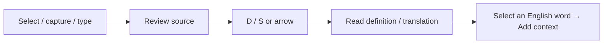

<div align="center">
  
  <h1>Yurelay</h1>
  <p><strong>Your words. Your pace.</strong><br />Selection and screenshot translation for macOS, with English vocabulary grounded in context.</p>


[](LICENSE)


[简体中文](README_cn.md) · [Downloads & releases](https://github.com/conanxyz/yurelay/releases) · [Contribute](CONTRIBUTING.md)
</div>

<p align="center">
  <picture>
    <source media="(prefers-color-scheme: dark)" srcset="docs/images/readme-current-translation-dark.png" />
    
  </picture>
</p>

<p align="center">Understand what you are reading. Keep the expressions worth remembering.<br />
<a href="docs/images/readme-current-translation-light.png">Light appearance</a> · <a href="docs/images/readme-current-translation-dark.png">Dark appearance</a></p>

[Recent updates](#updates) · [Workflow](#workflow) · [Vocabulary](#vocabulary) · [History](#history) · [Services](#services) · [Install](#install) · [Shortcuts](#shortcuts) · [Privacy](#privacy) · [Development](#development)

## 💡 Why Yurelay?

- **Review before translating.** Capture text, check or edit the source, then press `D` / `S` or click the arrow to request a translation. You choose when to send it.
- **Check sensitive text locally.** SensitiveGuard checks common seed-phrase, private-key and API-key formats, hiding matches and blocking them from sending.
- **Keep words with their context.** Look up and collect English source words, normalize inflections and keep encounters from different articles together.
- **Use your Mac's local tools.** OCR, system dictionary lookup and speech run locally. Yurelay is built with Tauri 2, Rust and Svelte 5, with service keys stored in macOS Keychain.

<a id="updates"></a>

## ✨ Recent additions and improvements

| Capability | How it works now |
| :--- | :--- |
| Submit after source capture | Release `Option`, then press `D` or `S` after the selection or OCR is ready; early presses and held-key repeats never queue a translation |
| Authorize an existing key | A safety explanation precedes Authorize and continue; access the saved Keychain item without re-entering the API key |
| Simpler source drafts | Read by default, edit with the pencil, append up to ten captures, and undo automatic PDF line-break cleanup when it changed text |
| Explain context and compose replies | Stop or regenerate explanations and replies independently of the main translation; reply text and back-translation are shown separately |
| Revisit learning words | Local highlights connect saved learning words and phrases to previous contexts and mastery controls without collecting again |
| Default service and fallback | New requests use the saved default; one switch enables compatible configured backups, with at most three services before any body text appears |
| Capture again after hiding | Switching apps hides the result by default; Escape and Hide keep the app running so you can return to the source and capture again |

Current examples appear below. They use the application's current components with synthetic data; see [media notes](docs/images/README.md) for capture dates, provenance and earlier native recordings.

<a id="workflow"></a>

## ⚡ From capture to reading

Select text in another app and press the default **`Option + D`** shortcut, or use **`Option + S`** to capture a screen region. Once the source is ready, release the shortcut and press **`D` or `S`** without modifiers to translate, or click the arrow. Capture/OCR in progress, held-key repeats, editable inputs and input-method composition do not trigger translation. You can also type or paste into the translation window.



Reading mode displays paragraphs, headings, lists and code blocks. Switch to plain text, or copy the translation and Markdown separately. By default, switching to another app hides the translation window; this can be disabled in Appearance settings. Hiding the window lets an active translation continue.

- **Build a source draft.** Turn on Append to combine up to ten selections or screenshots, then review before translating. Conservative PDF line-break cleanup runs locally after capture by default, with Undo cleanup when it changed the text. Editing or changing the active draft pauses append mode.
- **Read tables and formulas.** Apply a conservative OCR table layout when coordinates support it, compare saved images, and use local formula rendering with a plain-source fallback. The optional structure setting asks model translations to preserve columns, numbers, units and recognizable formulas; it cannot recover symbols missed by OCR.
- **Explain or reply explicitly.** Select a fragment and generate a contextual explanation, or open Compose reply and enter your intent. Each has its own Stop action. Reply writing inherits the selected service and source language; enter only what you want to say. The model polishes your intent into a natural reply, with a separately displayed reference in your translation language. Copy reply copies only the reply and sends nothing to another app.


**Wait for the source, then translate.** No translation request has been sent in this view. The source opens in reading mode; the pencil edits it, Append adds another capture, and the bottom hint shows `D / S`. Undo cleanup appears only when automatic cleanup actually changed the text.


**Turn intent into a reply.** Open Compose reply, describe what you want to say, then choose Generate reply. The reply follows the source language; its back-translation is initially collapsed. Copy reply copies only the reply and sends nothing to another app. Changed source or intent marks the old result as stale until you explicitly regenerate it.


*The examples use fictional text and preset outputs to show the interaction, not model quality or latency.*

<a id="vocabulary"></a>

## 📚 Dictionary lookup and contextual vocabulary

**Looking up a word?** Set **macOS system dictionary** as the default in Settings → Services to query enabled local dictionaries without an API key. With a model service selected, Yurelay chooses dictionary or passage instructions based on the input.

For a sentence or paragraph, the system dictionary offers configured translation services for the current query. Choose one, then press `D` / `S` or click the arrow to translate; your default service stays the same.

**Want to remember an expression?** Click or select an English source word for native lemmatization and a dictionary preview, then click **Add**. You can also collect words suggested by the model.

- Keep multiple source sentences and available meanings under one word; adding the same sentence again does not increase its count.
- Add personal notes, track Learning / Mastered status and search words or contexts.
- In Read source, learning words and short phrases can be highlighted locally. Click one to revisit saved contexts or mark it mastered; matching does not collect it again or increase its count.
- New candidates do not automatically open the sidebar. Opening it preserves the source reading position, and late data does not reopen a manually collapsed sidebar.
- Use UK / US pronunciation and slower playback when matching system voices are available.
- Export **CSV, Markdown or Anki TSV** for further study.


<a id="history"></a>

## 🕘 Revisit what you have read

In **Settings → History**, search source or translation text and filter selections, screenshots and typed text. Review the source, edited text, saved screenshot and translation, copy content or reopen the result window.

History defaults to **7 days**. Choose a custom duration, keep it forever or disable disk saving. Explicitly collected vocabulary is saved separately for longer-term study.

Explanations and replies follow their parent record’s retention; standalone results follow the same duration setting. Assistant history keeps up to 40 operations within 32 MiB, with five previous attempts per operation. Sensitive results explicitly allowed for one request stay in memory. Restarting never resends unfinished requests.


<a id="services"></a>

## 🔌 Bring your own translation service

| Service | Setup |
| :--- | :--- |
| macOS system dictionary | No key; uses enabled local dictionaries |
| Zhipu, SiliconFlow, DeepSeek, Qwen | API key + model name |
| Gemini, OpenAI, Claude | Provider API key + model name |
| MiniMax | Choose China or international region and its matching key |
| OpenRouter | API key + model ID |
| Youdao | Application ID + application secret |
| Custom service | OpenAI-compatible endpoint + model; key if required |

Open Settings → Services, choose a provider, configure it, test the connection, then set it as default and save. Presets include models such as Zhipu's `glm-4-flash-250414`; pricing, free allowances and availability depend on the provider. Connection tests send fixed sample text and may incur a charge.

Connection verification is bound to the saved endpoint, model and credential revision, and expires after seven days. Automatic fallback is off by default. If enabled, all configured compatible services are eligible, with at most three attempts before any result text appears. Connection tests report status and are not a prerequisite for fallback. This can incur charges at more than one provider; explicitly allowed sensitive requests do not fall back automatically.

New translations start with the default service saved in Settings. Results show the service that actually produced them, including an automatic fallback. Fallback does not change your default or the primary service chosen for that request. There is no separate next-service selector in the main reading window.

Translation and reply prompts have separate editors in Settings → Prompts. Services inherit them by default and can use a custom override. Existing per-service translation prompts are retained.


*Configure a service, set it as default and save. Saved keys are never displayed; Authorize saved key restores access when needed. The endpoint and model in this example are placeholders.*

<details>
<summary>View separate translation and reply prompt settings</summary>


Global prompts affect services that inherit them; custom service overrides remain independent. Save prompt changes to apply them. Existing requests are not automatically resent.

</details>

<a id="install"></a>

## 🚀 Install and get started

Requires **macOS 14 or newer**. When a package is published, download its `.dmg` from [Releases](https://github.com/conanxyz/yurelay/releases), open it and drag Yurelay into Applications. Choose `aarch64` for Apple Silicon or `x64` / `x86_64` for Intel. If no package is available yet, build from source below. A Homebrew installation channel is not yet available.

1. Allow **Accessibility** for text selection and **Screen Recording** for screenshots.
2. Choose the system dictionary or configure a model in Settings → Services.
3. Capture some text; once it is ready, press `D` / `S` or click the arrow.
4. If a saved key needs authorization, choose Authorize and continue and follow the macOS prompt.

<details>
<summary>First launch and permissions</summary>

The current workflow produces ad-hoc-signed development builds without Apple notarization. After confirming a trusted source, follow [Apple's instructions](https://support.apple.com/en-us/102445) to use **Open Anyway** in System Settings → Privacy & Security. If macOS reports a damaged file, check the file and release source first.

Accessibility enables selection from other apps; Screen Recording enables screenshots. Typing, pasting and local dictionary lookup do not require those two permissions. They are separate from signing, notarization and Keychain access. After updating a development build, consult Yurelay's permission recovery guide if needed.

</details>

<a id="shortcuts"></a>

## ⌨️ Shortcuts and interaction details

| Action | Default shortcut / entry point |
| :--- | :--- |
| Capture selected text | `Option + D` |
| Screenshot OCR | `Option + S` |
| Translate / expand or collapse translation | `D` / `S` or the arrow |
| Hide the result window | `Esc`; collapses an open vocabulary sidebar first |
| Reopen / settings | Menu bar icon or Dock |
| Export vocabulary | Settings → Vocabulary → Export |

<details>
<summary>Interaction details and FAQ</summary>

- **Can I change the shortcuts?** Global selection, screenshot and optional append bindings can be changed in Translation settings; conflicts are reported. The local second-step keys remain `D` / `S`.
- **Do D and S translate while I am typing?** In an input field, both keys type normally. Click the arrow or move focus outside the field before using the shortcut.
- **Can I hold D / S until capture completes?** No. Release and press again after the source is ready. `Option` / `Alt`, `Control` or `Command` combinations, input-method composition and editable fields do not submit a translation.
- **What happens if I press capture twice?** Duplicate requests are ignored during capture. The selection shortcut preserves the result while Yurelay has focus. A new screenshot can start after the current capture finishes or is cancelled.
- **What can I collect?** The source must be detected as English or explicitly set to English. A preview is saved only after clicking Add. Clicking or selecting translation text does not preview or collect vocabulary.
- **What limits apply to automatic extraction?** Enable it in settings for English source text. Inputs over 150 words or 800 characters skip automatic extraction; translation remains available.
- **Will a collapsed sidebar reopen?** Later model metadata does not reopen a manually collapsed sidebar. Deliberately selecting another source word can open its preview.
- **Does reading history call the model again?** No. A new request requires an explicit Translate again action.
- **What does history cleanup remove?** Expiry is based on creation time. Saving a shorter retention period removes expired records; disabling disk saving clears existing history. Deleting a record permanently removes its source, screenshot and translation after confirmation. Collected vocabulary is managed separately.
- **Do the Sentence / Dictionary mode buttons change translation mode?** In service settings, these buttons switch the default prompt preview. The input determines the actual processing mode.

</details>

<a id="privacy"></a>

## 🛡️ Privacy and security

Before captured text reaches the result window or a remote model, SensitiveGuard checks common English BIP-39 seed phrases, private-key formats and API keys. Matches are hidden and blocked from sending, and unreleased content is not saved to history. Detection can miss secrets or produce false positives; OCR and model output also need contextual judgment.

Service keys are encrypted in **macOS Keychain**, never stored in application settings or the history database. Startup reads silently without repeated authorization prompts. When you explicitly translate and a saved key needs authorization, Yurelay first explains its Keychain storage. Choose **Authorize and continue** to let macOS request access and resume translation without re-entering the API key. **Authorize saved key** is also available in service settings.

If macOS asks for a password, it is usually your **Mac login password (keychain password)**, not your API key. The system authorization dialog handles that password. Already-authorized access may need no prompt; each service has its own Keychain item, and a new development signature may require authorization again. Saving or deleting a key may also request access; cancelling authorization preserves the original key and settings. Local OCR, dictionary lookup and speech do not require a remote model; remote translation sends the source to your chosen provider. Do not include keys or private captures in issue reports. See [SECURITY.md](SECURITY.md) for security reports.


*This is Yurelay's explanation, not the system password dialog. macOS decides whether a password is needed next. Cancelling keeps the original key and sends no translation.*

The `readme-current-*` images were captured on 2026-10-22 from the current frontend using local Playwright fixtures, Chinese labels and synthetic data. They connect to no real provider, Keychain item or user history. They illustrate the interface and do not verify macOS permissions or capture APIs. Earlier native images and the edited walkthrough remain in the media directory; see [media notes](docs/images/README.md).

<a id="development"></a>

## 🛠️ Build and contribute

Install Xcode Command Line Tools, rustup, Node.js 24 and Python 3.11+. The repository selects its pinned Rust toolchain.

```sh
npm ci
npx playwright install chromium
npm run tauri -- dev
./scripts/verify.sh
sh scripts/test-native.sh
npm run bundle:mac
```

See [CONTRIBUTING.md](CONTRIBUTING.md) for architecture, development and release checks.

## 📄 License and acknowledgements

Copyright © 2026 Yurelay Contributors. Licensed under **GNU GPL v3.0 only (`GPL-3.0-only`)**; see [LICENSE](LICENSE).

Yurelay draws on the product and interaction design of [Easydict](https://github.com/tisfeng/Easydict) and [Bob](https://github.com/ripperhe/Bob). Easydict's implementations of text selection, screenshot capture, OCR and translation provider integrations were also studied during development. Thank you to these projects and their authors for sharing their ideas and experience.

Thanks to the Tauri, Rust, Svelte and wider open-source communities. See [third-party notices](THIRD_PARTY_NOTICES.md) for dependencies, fonts and provider marks.
