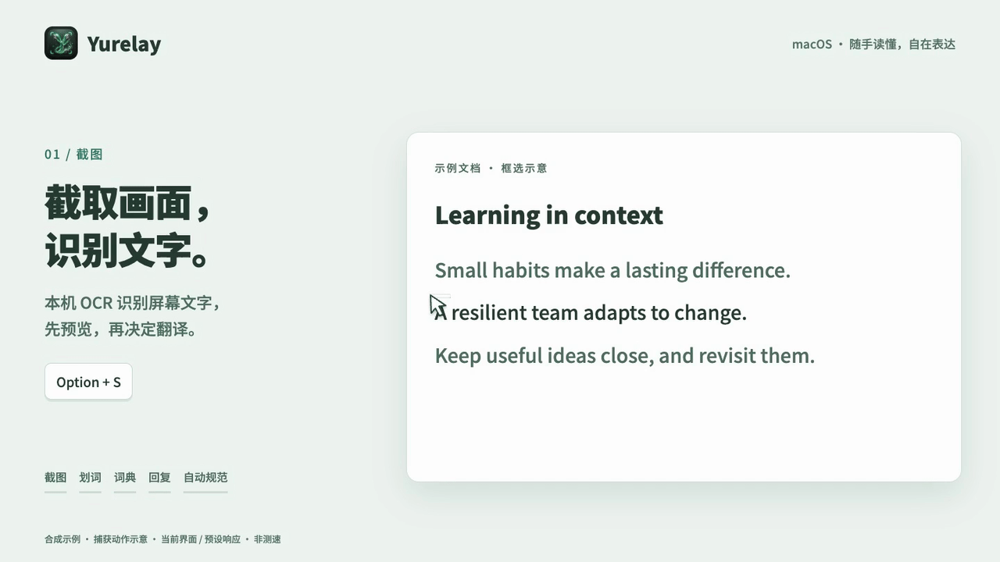

<div align="center">
  
  <h1>Yurelay</h1>
  <p><strong>你的语言，你的节奏</strong><br />macOS 划词与截图翻译：先整理原文、按需翻译，留住语境，用母语构思回复。</p>


[](LICENSE)


[English](README.md) · [下载安装包](https://github.com/conanxyz/yurelay/releases) · [FAQ](docs/FAQ_cn.md) · [参与贡献](CONTRIBUTING.md)

<picture>
  <source media="(prefers-reduced-motion: reduce)" srcset="docs/images/yurelay-features-zh-poster.png" />
  
</picture>

[观看 MP4](docs/images/yurelay-features-zh.mp4) · [演示说明](docs/images/README.md)
</div>

<a id="features"></a>

## ✨ 为什么选择 Yurelay？

为需要认真读懂外语、积累表达和跨语言沟通的人而做。

- **先整理，再翻译。** 划词或截图后先预览原文，整理 PDF 句中断行、修正 OCR 文字，也能追加多段内容。确认后按 `D` / `S` 才发起翻译。支持表格整理与公式展示。
- **用母语构思回复。** 写下想表达的意思，结合上文语境生成原文语种的回复，并附回译参考。遇到难懂的片段，也可单独生成语境解析。
- **把生词留在语境里。** 点选英语原文查词、词形还原，收录时保留原句；阅读时可高亮学习中的词汇。支持英/美发音和 **Anki TSV、CSV、Markdown** 导出。
- **本机能力，服务自选。** OCR、系统词典与朗读在本机完成；查词无需 API Key，也可接入自己的翻译服务，设置提示词和自动备用。
- **敏感信息，本机先检查。** SensitiveGuard 检查常见 BIP-39 助记词、私钥与 API Key 格式，命中后隐藏内容并阻止发送。服务密钥仅保存在 macOS 系统钥匙串。

远程翻译会把原文发送给你选择的服务商；敏感信息检测可能误报或漏报。更多说明见 [隐私与钥匙串](docs/FAQ_cn.md#privacy)。

<a id="install"></a>

## 🚀 安装与快速开始

需要 **macOS 14+**。从 [Releases](https://github.com/conanxyz/yurelay/releases) 获取 `.dmg`，将 Yurelay 拖入“应用程序”：Apple Silicon 选择 `aarch64`，Intel 选择 `x64` / `x86_64`。若暂无对应安装包，可从源码构建。

1. **开启权限：** 按引导开启辅助功能（划词）和屏幕录制（截图）权限。
2. **选择服务：** 在「设置 → 服务」选择本机词典，或配置自己的模型服务，设为默认并保存。
3. **开始使用：** 选中文字按 `Option + D`，或按 `Option + S` 截图；原文就绪后松开快捷键，再单独按 `D` / `S` 或点击箭头。

当前构建包未经 Apple 公证。首次打开提示与钥匙串授权方法见 [安装与权限](docs/FAQ_cn.md#install) 和 [钥匙串说明](docs/FAQ_cn.md#privacy)。

<a id="shortcuts"></a>

## ⌨️ 快捷键与常用入口

| 操作 | 默认快捷键 / 入口 |
| :--- | :--- |
| 划词取词 | `Option + D` |
| 截图 OCR | `Option + S` |
| 翻译 / 展开或收起译文 | 原文就绪后单独按 `D` / `S`，或点击箭头 |
| 语境解析 / 构思回复 | 结果窗口内对应按钮 |
| 隐藏窗口 | `Esc`；生词侧栏展开时先收起侧栏 |
| 历史记录 / 生词本 | 设置内对应页面；历史默认保留 7 天，生词独立管理 |

快捷键自定义、追加原文、历史保留和常见问题见 [FAQ 说明文档](docs/FAQ_cn.md)。

<a id="services"></a>

## 🔌 支持的服务

- **本机词典：** macOS 系统词典，无需 API Key。
- **模型服务：** DeepSeek、智谱 AI、通义千问、硅基流动、MiniMax（中国区 / 国际区）、OpenAI、Claude、Gemini。
- **聚合与翻译接口：** OpenRouter、有道智云。
- **自定义：** OpenAI 兼容地址与模型，按服务要求配置密钥。

支持全局与分服务提示词，以及可选的自动备用切换（默认关闭）。模型请求与连接测试可能计费，费用和可用性以服务商为准。配置方式见 [服务设置](docs/FAQ_cn.md#services)。

<a id="development"></a>

## 🛠️ 本地构建

准备 Xcode Command Line Tools、Rust（rustup）、Node.js 24 和 Python 3.11+。仓库会选择固定的 Rust 工具链。

```sh
npm ci
npm run tauri -- dev
npm run bundle:mac
```

测试、架构与贡献流程见 [CONTRIBUTING.md](CONTRIBUTING.md)；安全问题报告见 [SECURITY.md](SECURITY.md)。

## 📄 开源协议与致谢

Copyright © 2026 Yurelay Contributors. 本项目基于 **GPL-3.0-only** 开源，见 [LICENSE](LICENSE)。

Yurelay 的功能与交互设计参考了 [Easydict](https://github.com/tisfeng/Easydict) 与 [Bob](https://github.com/ripperhe/Bob)，开发中也研究了 Easydict 的划词、截图、OCR 与服务接入实现。感谢原作者，以及 Tauri、Rust、Svelte 和开源社区。依赖、字体与服务商标志的许可见 [第三方声明](THIRD_PARTY_NOTICES.md)。
