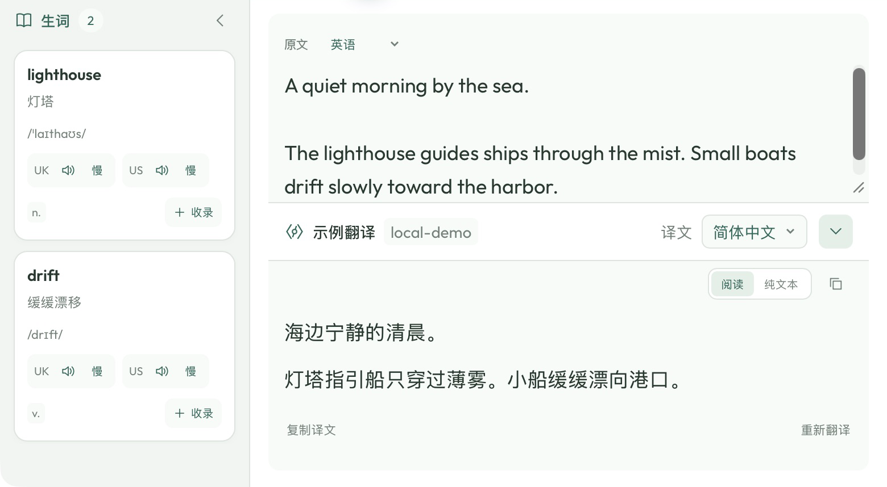
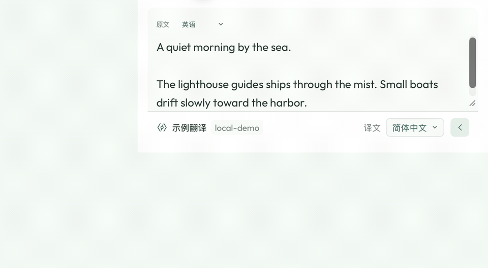
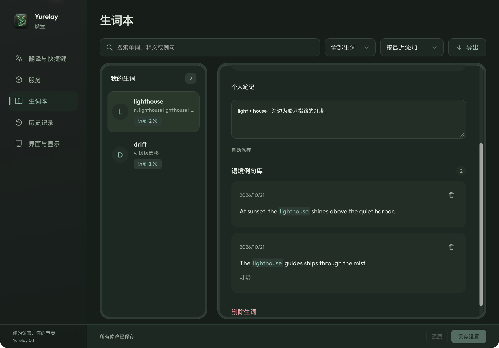
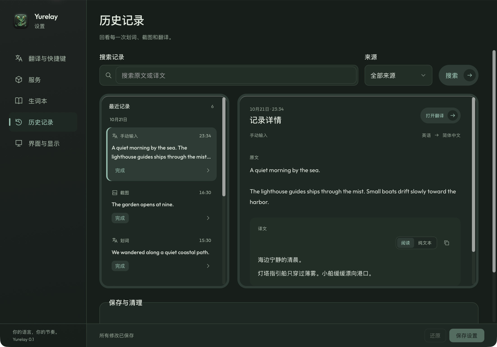

<div align="center">
  
  <h1>Yurelay</h1>
  <p><strong>你的语言，你的节奏</strong><br />macOS 划词与截图翻译，把值得记住的英语表达留在语境里。</p>


[](LICENSE)


[English](README.md) · [下载与版本](https://github.com/conanxyz/yurelay/releases) · [参与贡献](CONTRIBUTING.md)
</div>

<p align="center">
  <picture>
    <source media="(prefers-color-scheme: dark)" srcset="docs/images/readme-translation-dark.png" />
    
  </picture>
</p>

<p align="center">先读懂眼前的内容，再留下值得记住的表达。<br />
<a href="docs/images/readme-translation-light.png">浅色画面</a> · <a href="docs/images/readme-translation-dark.png">深色画面</a></p>

## 💡 为什么选择 Yurelay？

- **先审阅，再翻译。** 划词或截图后先显示原文；检查、修改后，再按 `X` 或点击箭头请求模型，让每次发送都有明确意图。
- **敏感信息在本机先检查。** SensitiveGuard 检查常见助记词、私钥和 API Key 格式，命中后隐藏原文并阻止发送。
- **记住单词，也记住它出现在哪里。** 从英语原文查词、收录，用词形还原合并词条，把不同文章中的语境放在一起。
- **本地能力随手可用。** 截图 OCR、系统词典和语音朗读在本机完成；应用基于 Tauri 2、Rust 和 Svelte 5 构建，服务密钥保存在 macOS 钥匙串。

## ⚡ 从捕获到阅读

在其他应用中选中文字，按默认快捷键 **`Option + D`**；或按 **`Option + S`** 框选屏幕文字。也可以直接在翻译框输入或粘贴。


阅读模式展示段落、标题、列表和代码块；可切换纯文本，分别复制译文或 Markdown。隐藏窗口后，已经开始的翻译继续运行。

- **合并原文草稿。** 开启“追加”可合并最多十段划词或截图，确认后再翻译。捕获后默认在本机保守整理 PDF 句中换行，确实产生变更时可“撤销整理”；编辑原文或切换草稿会暂停追加。
- **阅读表格与公式。** OCR 坐标足够明确时，可手动应用表格整理并对照原图。公式在本地排版，失败时保留源码；可选“保留表格与公式结构”会要求模型保留列、数字、单位和可辨认公式，但无法还原 OCR 已遗漏的符号。
- **明确发起解析与回复。** 选中片段后点击生成语境解析，或打开“构思回复”填写意图；两者均可独立停止。回复沿用当前服务与原文语种，只需填写想表达什么；模型会按语境润色成自然的母语表达，并附当前译文语言的折叠回译参考。“复制回复”仅复制正文，不会向其他应用粘贴或发送。


<details>
<summary>观看实机动图：预览 → 翻译 → 选词 → 收录</summary>

<picture>
  <source media="(prefers-reduced-motion: reduce)" srcset="docs/images/readme-translation-light.png" />
  
</picture>

片段从已经输入的原文开始；录制使用本地演示响应，展示操作过程，不代表远程模型的速度。

</details>

## 📚 查词与语境生词本

**只想查一个词？** 在「设置 → 服务」把 **macOS 系统词典**设为默认，即可查询本机已启用词典中的单词和短语，无需 API Key。选择模型服务时，Yurelay 会按输入内容使用词典或段落提示词。

遇到整句或段落，系统词典会提示为当前查询选择已配置的翻译服务；选好后按 `X` 或点击箭头才会开始翻译，全局默认服务保持不变。

**想把表达留下来？** 点击或划选英语原文中的单词，先看本机词形还原和词典预览，再点击“收录”。也可以从模型提炼的英语候选中收录。

- 一词保留多段原句和可用释义，同一句重复收录不会重复计数。
- 支持个人笔记、学习中 / 已掌握状态、词条与语境搜索。
- 侧栏提供英式 / 美式及慢速朗读，使用本机可用语音。
- 可导出 **CSV、Markdown 或 Anki TSV**，继续整理和复习。



“阅读原文”可在本地标记正在学习的单词和短语，点击即可查看旧语境或标为已掌握。匹配本身不再次收录，也不增加计数。

## 🕘 读过的内容，随时找回

在「设置 → 历史记录」按原文、译文或来源查找，回看划词、截图与手动输入的记录。可以查看原文、修正后的文本、已保存截图和译文，复制内容或重新打开翻译框。

历史默认保留 **7 天**，也可指定天数、永久保存或不保存到磁盘。已经明确收录的生词独立保存，方便长期积累。

解析和回复沿用父记录的保留时间；独立结果采用相同的保留设置。辅助操作历史最多保留 40 个操作、合计 32 MiB，每个操作保留五次旧尝试。单次放行的敏感结果仅驻留内存；重启不会重发未完成请求。



## 🔌 使用自己的翻译服务

| 服务 | 配置方式 |
| :--- | :--- |
| macOS 系统词典 | 无需密钥，使用本机已启用的词典 |
| 智谱 AI、硅基流动、DeepSeek、通义千问 | API Key + 模型名称 |
| Gemini、OpenAI、Claude | 对应平台的 API Key + 模型名称 |
| MiniMax | 选择中国区或国际区，使用对应区域的密钥 |
| OpenRouter | API Key + 模型 ID |
| 有道智云 | 应用 ID + 应用密钥 |
| 自定义服务 | OpenAI 兼容地址 + 模型名称，按服务要求填写密钥 |

打开「设置 → 服务」，选择服务、填写配置、测试连接，最后设为默认并保存。服务预置了部分模型候选，例如智谱 `glm-4-flash-250414`；费用、免费额度和可用性以服务商为准。测试连接也会发送固定示例文本，可能计费。

连接验证与已保存的地址、模型和凭据版本绑定，七天后过期。自动备用服务默认关闭；开启后，所有已配置且能力兼容的服务默认成为候选，正文出现前最多尝试三次，无需逐个勾选或预先测试。连接测试仍提供状态信息。这可能产生多家供应商的费用；单次放行的敏感请求不自动转移。

“设置 → 提示词”分别管理翻译与回复提示词。服务默认引用全局设置，也可自定义覆盖；已有的服务翻译提示词会保留。

## 🚀 安装与开始使用

需要 **macOS 14 或更新版本**。安装包发布后，可从 [Releases](https://github.com/conanxyz/yurelay/releases) 下载 `.dmg`，打开后将 Yurelay 拖入“应用程序”。Apple Silicon 选择 `aarch64`，Intel 选择 `x64` / `x86_64`；页面暂无安装包时，可按文末步骤从源码构建。Homebrew 安装渠道尚未提供。

1. 为划词开启**辅助功能**权限，为截图开启**屏幕录制**权限。
2. 在「设置 → 服务」选择系统词典，或配置自己的模型服务。
3. 捕获一段文字，检查原文后点击箭头开始。

<details>
<summary>首次打开与权限说明</summary>

当前工作流生成的是临时签名、未经 Apple 公证的开发包。确认来源可信后，可按 [Apple 官方说明](https://support.apple.com/zh-cn/102445)，在「系统设置 → 隐私与安全性」选择“仍要打开”。提示文件损坏时，应先核实文件与发布来源。

辅助功能用于跨应用取词，屏幕录制用于截图；仅手动输入、粘贴或本地查词不需要这两项权限。它们与应用签名、公证和钥匙串访问分别管理。更新开发包后，必要时在 Yurelay 的权限页面查看恢复指引。

</details>

## ⌨️ 快捷键与交互细节

| 操作 | 默认快捷键 / 入口 |
| :--- | :--- |
| 划词取词 | `Option + D` |
| 截图 OCR | `Option + S` |
| 开始翻译 / 展开或收起译文 | `X` 或箭头按钮 |
| 隐藏翻译框 | `Esc`；生词侧栏展开时先收起侧栏 |
| 找回窗口 / 打开设置 | 菜单栏图标或 Dock |
| 导出词条 | 设置 → 生词本 → 导出 |

<details>
<summary>交互细节与 FAQ</summary>

- **按键可以修改吗？** 可以，在「设置 → 翻译与快捷键」中录入；上表为默认值，实际以你的配置为准，冲突时会提示。
- **输入框里的 X 会翻译吗？** 编辑文字时正常输入 `X`；请点击箭头，或将焦点移出输入框后再用快捷键。
- **连按两次捕获快捷键会怎样？** 当前取词或截图未结束时忽略重复请求；翻译框获得焦点后再次按划词快捷键会保留结果。截图完成或取消后，可再次触发。
- **什么内容能收进生词本？** 原文需被识别为英语或手动指定为英语；预览后明确点击“收录”才保存。点击或划选译文不会触发预览或收录。
- **自动提词有什么限制？** 在设置中开启后，模型可为英语原文提供候选；超过 150 词或 800 字符的输入会跳过自动提词，翻译仍可继续。
- **收起侧栏后会自动弹回来吗？** 后续模型元数据不会重新打开手动收起的侧栏；主动在原文重新选词可以打开预览。
- **浏览历史会再次调用模型吗？** 不会；主动点击“重新翻译”才会发起新请求。
- **历史清理会删除什么？** 保留期按创建时间计算；保存较短期限会清理已过期记录，关闭磁盘保存会清理已有历史。删除一条历史会一并删除其原文、截图与译文，确认后不可撤销。已收录词条在生词本中单独管理。
- **“段落模式 / 词典模式”是手动切换翻译方式吗？** 服务设置里的按钮切换默认提示词预览；实际处理模式由输入内容选择。

</details>

## 🛡️ 隐私与安全

SensitiveGuard 在捕获文字进入结果窗口和发送给模型前，检查常见英文 BIP-39 助记词、私钥和 API Key 格式；命中后隐藏明文并阻止发送，未放行的内容不写入历史。检测可能误报或漏报，模型译文和 OCR 结果也需要结合上下文核对。

服务密钥仅保存在 **macOS Keychain**。本机 OCR、词典与朗读不需要远程模型；远程翻译会将原文发送给你选择的服务商。问题报告请勿附带密钥或私人捕获内容，安全问题见 [SECURITY.md](SECURITY.md)。

本文图片录制于真实 macOS 应用窗口，使用隔离的示例数据与本地演示响应；已裁去系统录制控件，动图经过剪辑。素材说明见 [docs/images/README.md](docs/images/README.md)。

## 🛠️ 本地构建与贡献

准备 Xcode Command Line Tools、rustup、Node.js 24 和 Python 3.11+。仓库会选择固定的 Rust 工具链。

```sh
npm ci
npx playwright install chromium
npm run tauri -- dev
./scripts/verify.sh
npm run bundle:mac
```

开发流程、架构约束和发布验证见 [CONTRIBUTING.md](CONTRIBUTING.md)。

## 📄 开源协议与致谢

Copyright © 2026 Yurelay Contributors. 项目按 **GNU GPL v3.0 only（`GPL-3.0-only`）** 开源，见 [LICENSE](LICENSE)。

Yurelay 的功能与交互设计参考了 [Easydict](https://github.com/tisfeng/Easydict) 和 [Bob](https://github.com/ripperhe/Bob)。开发过程中，也对照 Easydict 的划词、截图、OCR 与翻译服务接入实现进行了研究。感谢这些项目及其作者分享思路与经验。

感谢 Tauri、Rust、Svelte 及相关开源社区。依赖、字体和服务商标志的许可见 [第三方声明](THIRD_PARTY_NOTICES.md)。
